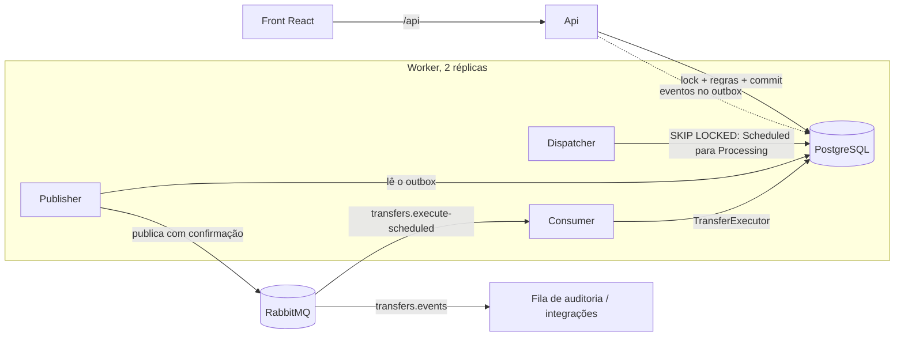

# Transferências Financeiras

[](https://github.com/Jeane-Cristina/transfers/actions/workflows/ci.yml)

API REST em .NET 10 com Worker e front-end em React para **realizar, agendar, consultar e cancelar transferências entre contas**, com cheque especial, limites por hora (dia e noite), autenticação JWT e controle de concorrência.

Teste técnico para a vaga de Desenvolvedor .NET Pleno da Brasil Terrenos Holding.

## Sumário

- [Como executar](#como-executar)
- [Contas de demonstração](#contas-de-demonstração)
- [Testes](#testes)
- [Arquitetura](#arquitetura)
- [Decisões técnicas](#decisões-técnicas)
- [Premissas assumidas](#premissas-assumidas)
- [Cenários do enunciado e testes](#cenários-do-enunciado-e-testes)
- [Endpoints](#endpoints)
- [O que eu faria com mais tempo](#o-que-eu-faria-com-mais-tempo)

## Como executar

### Com Docker (recomendado)

Requisito: Docker Desktop.

```bash
docker compose up --build
```

Na primeira vez o build leva alguns minutos. Sobem 6 containers: PostgreSQL, RabbitMQ, Api, duas réplicas do Worker e o front.

| Serviço | Endereço |
| --- | --- |
| Front-end | http://localhost:8080 |
| Swagger | http://localhost:5080/swagger |
| Health check | http://localhost:5080/health |
| RabbitMQ (painel) | http://localhost:15672 (usuário e senha `transfers`) |

A Api aplica as migrations e cria as contas de demonstração ao subir. A chave do JWT pode ser trocada pela variável `JWT_KEY`.

### Em modo de desenvolvimento

Requisitos: .NET SDK 10, Node 20.19+ e Docker.

```bash
docker compose up -d postgres rabbitmq
dotnet tool restore
dotnet run --project src/Transfers.Api       # http://localhost:5211/swagger
dotnet run --project src/Transfers.Worker
cd web && npm install && npm run dev          # http://localhost:5173
```

## Contas de demonstração

Todas usam a senha **`Senha@123`**. Na tela de login, a lista de demonstração preenche os dados com um clique.

| Titular | CPF | Saldo | Cheque especial | Para testar |
| --- | --- | --- | --- | --- |
| Ana Souza | 111.111.111-11 | R$ 500,00 | R$ 1.000,00 | Uso do cheque especial |
| Bruno Lima | 222.222.222-22 | −R$ 800,00 | R$ 1.000,00 | Recebimento cobrindo o especial |
| Carla Dias | 333.333.333-33 | R$ 20.000,00 | — | Limites por hora |
| Diego Rocha | 444.444.444-44 | R$ 100,00 | — | Conta bloqueada |

Também é possível criar uma conta pela tela "Criar conta" (o CPF é validado pelos dígitos verificadores). Contas novas começam com saldo R$ 0,00 e cheque especial de R$ 500,00, valores configuráveis em `NewAccounts`.

**No Swagger:** chame `POST /api/auth/login` com `{ "document": "11111111111", "password": "Senha@123" }`, copie o `token` e cole em **Authorize**.

## Testes

```bash
dotnet test
```

O Docker precisa estar ligado: os testes de integração sobem um PostgreSQL real com Testcontainers.

| Projeto | Quantidade | O que cobre |
| --- | --- | --- |
| `Transfers.UnitTests` | 33 | Regras do domínio sem banco: cheque especial, limites, período noturno, máquina de estados da transferência |
| `Transfers.IntegrationTests` | 34 | A Api inteira contra PostgreSQL real: cenários do enunciado, concorrência, agendamento, idempotência, autenticação e cadastro |

O CI (GitHub Actions) roda os testes, o build do front e o build das imagens Docker a cada push.

## Arquitetura



```text
src/
├── Transfers.Domain/          entidades, objetos de valor, eventos e regras puras
├── Transfers.Application/     casos de uso e portas (interfaces)
├── Transfers.Infrastructure/  EF Core, repositórios, outbox, RabbitMQ, jobs, autenticação
├── Transfers.Api/             endpoints, JWT, ProblemDetails, Swagger
└── Transfers.Worker/          host dos jobs (só registra os serviços)
tests/
├── Transfers.UnitTests/
└── Transfers.IntegrationTests/
web/                           React + TypeScript + Vite
```

As dependências apontam sempre para dentro: o Domain não referencia ninguém, a Application referencia só o Domain e a Infrastructure implementa as portas da Application. O domínio não conhece EF, HTTP nem RabbitMQ e é testado sem nenhum deles.

**Um único lugar com as regras.** A transferência imediata (pela Api) e a agendada (pelo Worker, via fila) passam pelo mesmo `TransferExecutor`, que trava as contas, lê o uso da última hora e chama o serviço de domínio `TransferProcessor`.

## Decisões técnicas

### Concorrência

Antes de qualquer regra, o executor trava as duas contas com `SELECT ... FOR UPDATE`, **sempre ordenadas por id** e dentro de uma transação:

- Duas transferências na mesma conta ficam em fila no banco; a segunda enxerga o saldo já atualizado pela primeira.
- A ordem fixa evita deadlock entre transferências cruzadas (A→B e B→A ao mesmo tempo).
- O uso da última hora é lido **depois** do lock, então o mesmo lock protege o saldo e o limite por hora.
- `lock_timeout` de 5 s: ninguém espera para sempre (responde 503).

Escolhi lock pessimista em vez de otimista (`xmin`) porque disputa pela mesma conta é o cenário esperado: com lock otimista, as requisições concorrentes falhariam e precisariam de retry.

Provas: `Transferencias_simultaneas_nao_gastam_o_mesmo_saldo` (10 pedidos simultâneos de R$ 400 com R$ 1.500 disponíveis resultam em exatamente 3 concluídos) e `Transferencias_cruzadas_simultaneas_nao_causam_deadlock`.

### Cheque especial

A conta guarda um **único saldo com sinal**. A regra "o crédito cobre primeiro o especial usado" sai da própria aritmética (−800 + 1.000 = 200), sem dois campos que poderiam discordar. O banco reforça a regra com a check constraint `balance >= -overdraft_limit`.

### Limites por hora

- Janela deslizante de 60 minutos, usando o teto do período no momento da tentativa.
- O teto de **valor** soma só transferências concluídas; o de **tentativas** soma concluídas e recusadas.
- Recusas por regra são gravadas como `Failed` justamente para contarem como tentativa.
- Período noturno configurável em `TransferRules` (padrão 20h às 6h, horário de Brasília). O relógio é injetado (`TimeProvider`) e substituído nos testes.

### Agendamento e mensageria

1. O agendamento é salvo como `Scheduled`.
2. O **dispatcher** busca os vencidos com `FOR UPDATE SKIP LOCKED`, muda para `Processing` e grava o comando no **outbox**, na mesma transação. Com duas réplicas, cada uma pega lotes diferentes.
3. O **publisher** envia o outbox ao RabbitMQ com confirmação do broker.
4. O **consumer** chama o executor, que revalida saldo, cheque especial e limites no momento da execução.

Por que outbox: o evento é só mais uma linha da mesma transação, então nunca há evento de algo que não aconteceu, nem evento perdido se o processo cair. A Api não depende do RabbitMQ: com o broker fora, transferências continuam funcionando e os eventos saem quando ele volta.

O consumer é **idempotente pelo status** (a entrega do RabbitMQ é "pelo menos uma vez"). A fila é *quorum* com `x-delivery-limit` e dead-letter: falhas técnicas repetidas não travam a fila.

Escolhi `RabbitMQ.Client` em vez de MassTransit porque o MassTransit v9 passou a ter licença comercial e o v8 só tem manutenção oficial até o fim de 2026. Pelo mesmo motivo, não usei MediatR.

### Eventos de domínio

As entidades registram `TransferScheduled`, `TransferCompleted`, `TransferFailed` e `TransferCancelled`. Um interceptor do EF transforma esses eventos em linhas do outbox dentro do `SaveChanges`, sem que nenhum caso de uso precise lembrar de publicá-los. Eles são publicados na exchange `transfers.events`, pronta para outros sistemas consumirem.

### Idempotência

Header `Idempotency-Key` em `POST /api/transfers` e `/scheduled`. Mesma chave e mesmo corpo devolvem a transferência original (com o header `Idempotent-Replayed: true`); mesma chave com corpo diferente responde 409. A checagem acontece depois do lock da conta, sem janela de corrida, com um índice único como rede de segurança. O front gera uma chave por intenção de envio, o que protege contra duplo clique e reenvio.

### Autenticação

JWT com login por CPF e senha (hash PBKDF2 do ASP.NET Core Identity). Cada pessoa só consulta e movimenta a própria conta: origem de outra pessoa responde 403. Quando o CPF não existe, o login faz o mesmo cálculo de hash de uma senha real, para que o tempo de resposta não indique quais CPFs estão cadastrados.

### Respostas da API

| Situação | HTTP | Persiste? | Conta como tentativa? |
| --- | --- | --- | --- |
| Transferência concluída | 201 | Sim | Sim |
| Recusada por regra (saldo, limite, tentativas, conta bloqueada) | 422 | Sim, como `Failed` | Sim |
| Requisição inválida (valor, mesma conta, data passada) | 400 | Não | Não |
| Conta ou transferência inexistente | 404 | Não | Não |
| Conta de outra pessoa | 403 | Não | Não |
| Conflito (cancelar o que não está agendado, chave reutilizada) | 409 | Não | Não |
| Lock não obtido em 5 s | 503 | Não | Não |

Todos os erros seguem o formato ProblemDetails, com um campo `code` estável para o front traduzir.

### Banco de dados

- Valores em `numeric(18,2)`, datas em UTC e período noturno calculado em `America/Sao_Paulo`.
- Check constraints: saldo dentro do especial, valor positivo, origem diferente do destino.
- Índices criados a partir das consultas reais: `(source_account_id, processed_at)` para a janela da hora, índice parcial em `scheduled_for` só para agendadas (o worker), e índice único em `idempotency_key`.

## Premissas assumidas

O enunciado deixa algumas lacunas; estas foram as decisões:

- O período noturno vai das 20h às 6h no horário de Brasília (configurável).
- A ordem das validações é: tentativas, contas ativas, valor da hora, saldo.
- Requisição malformada (400/404) não conta como tentativa; recusa por regra (422) conta.
- O agendamento valida existência e situação das contas, mas não saldo nem limite, que são verificados na execução. Agendar não conta como tentativa.
- Uma pessoa tem uma conta (o CPF é único), então o limite "por pessoa" fica guardado na conta.
- Uso o .NET 10 porque o .NET 8 saiu de suporte em 10/11/2026.

## Cenários do enunciado e testes

| Cenário | Teste |
| --- | --- |
| Transferência com saldo suficiente | `Transferencia_com_saldo_suficiente` |
| Transferência utilizando cheque especial | `Transferencia_utilizando_cheque_especial` |
| Transferência que ultrapassa o cheque especial | `Transferencia_que_ultrapassa_o_cheque_especial` |
| Recebimento enquanto a conta usa cheque especial | `Recebimento_enquanto_a_conta_utiliza_cheque_especial` |
| Transferência acima do limite da hora | `Transferencia_acima_do_limite_da_hora` |
| Excesso de tentativas dentro da hora | `Excesso_de_tentativas_conta_inclusive_as_rejeitadas` |
| Transferência durante o período noturno | `Transferencia_durante_o_periodo_noturno` |
| Agendada sem saldo no momento da execução | `Agendada_sem_saldo_no_momento_da_execucao_falha` |
| Duas transferências simultâneas no mesmo saldo | `Transferencias_simultaneas_nao_gastam_o_mesmo_saldo` |

## Endpoints

| Método | Endpoint | Descrição |
| --- | --- | --- |
| POST | `/api/auth/login` | Entra com CPF e senha e recebe o JWT |
| POST | `/api/auth/register` | Cria uma conta e já devolve o JWT |
| GET | `/api/auth/me` | Conta da pessoa logada |
| POST | `/api/transfers` | Realizar transferência |
| POST | `/api/transfers/scheduled` | Agendar transferência |
| POST | `/api/transfers/{id}/cancel` | Cancelar agendamento |
| GET | `/api/transfers/{id}` | Consultar transferência |
| GET | `/api/accounts` | Diretório de destinatários (nome e situação) |
| GET | `/api/accounts/{id}` | Consultar a própria conta |
| GET | `/api/accounts/{id}/transfers` | Extrato paginado |
| GET | `/api/accounts/{id}/usage` | Uso do limite na última hora |
| GET | `/health` | Saúde da Api e do banco |

## Front-end

React 19 + TypeScript + Vite, TanStack Query, React Router, react-hook-form e zod.

- Início no estilo de app de banco: saldo, ações rápidas, cheque especial, limite da hora e últimas movimentações.
- Ícone de olho que oculta todos os valores (escolha salva no navegador).
- Nova transferência em três etapas, com resumo ao vivo que confere saldo e limites antes do envio e uma tela de revisão.
- Comprovante com linha do tempo que atualiza sozinha e opção de imprimir.
- Extrato agrupado por dia, login, cadastro com validação de CPF e modo escuro.
- Responsivo (navegação inferior no celular), com foco visível no teclado, rótulos nos controles e mudanças de status anunciadas para leitores de tela.

## O que eu faria com mais tempo

- **Livro-razão (ledger):** guardar lançamentos imutáveis de débito e crédito e derivar o saldo deles, o padrão de sistemas financeiros, com auditoria completa.
- **Segredos fora do repositório:** a chave do JWT viria de um cofre (Azure Key Vault, AWS Secrets Manager) em vez do `appsettings.json`.
- **Observabilidade:** OpenTelemetry ligando a requisição, o outbox, a fila e o consumer num mesmo trace.
- **Rate limiting** na borda e bloqueio progressivo de tentativas de login.
- **Teste de carga** (k6) para medir o comportamento da fila de locks numa conta disputada.
- **Consumidores de eventos:** a exchange `transfers.events` já permite que outros sistemas, como um app de finanças pessoais, acompanhem as transferências sem acoplamento.
